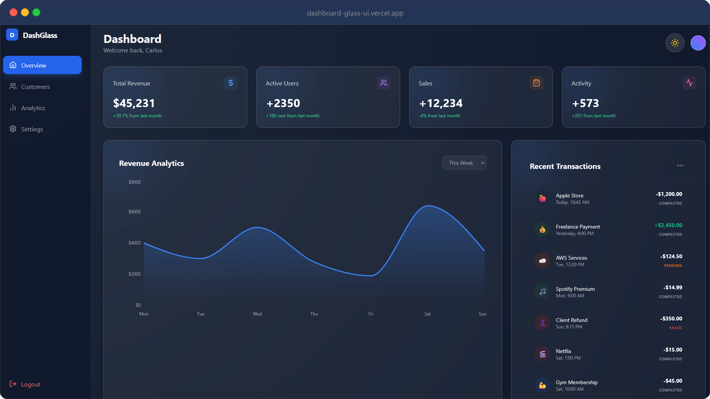

# Glass Dashboard

A dark-first analytics dashboard built with React, Tailwind CSS and Recharts. The interface
is built on glassmorphism: translucent surfaces over a radial gradient, with a light theme
you can toggle from the header.

**[Live demo](https://dashboard-glass-ui.vercel.app)**



## What it does

- Four KPI cards — revenue, users, sales, activity — driven by a single `StatsCard`
  component with per-card accent colors
- Revenue area chart built with Recharts, including a custom tooltip
- Recent transactions list with status badges for completed, pending and failed payments
- Fixed sidebar with the active section highlighted
- Theme toggle that swaps the background gradient, text colors and card surfaces

## Stack

React 19 · Vite · Tailwind CSS · Framer Motion · Recharts · Lucide React

## Run locally

```bash
npm install
npm run dev
```

The dev server starts at `http://localhost:5173`. To build:

```bash
npm run build
npm run preview
```

## Structure

```
src/
├── components/
│   ├── GlassCard.jsx          # Reusable translucent surface
│   ├── Sidebar.jsx
│   ├── SalesChart.jsx         # Recharts area chart
│   └── RecentTransactions.jsx
├── App.jsx                    # Layout, KPI grid and theme state
└── index.css
```

## Notes

The dashboard is a frontend exercise. Every figure, chart point and transaction is
hardcoded inside the components — there is no API, database or authentication behind it.
The layout is designed for desktop and collapses to a single column below 1024 px; the
sidebar stays fixed.
